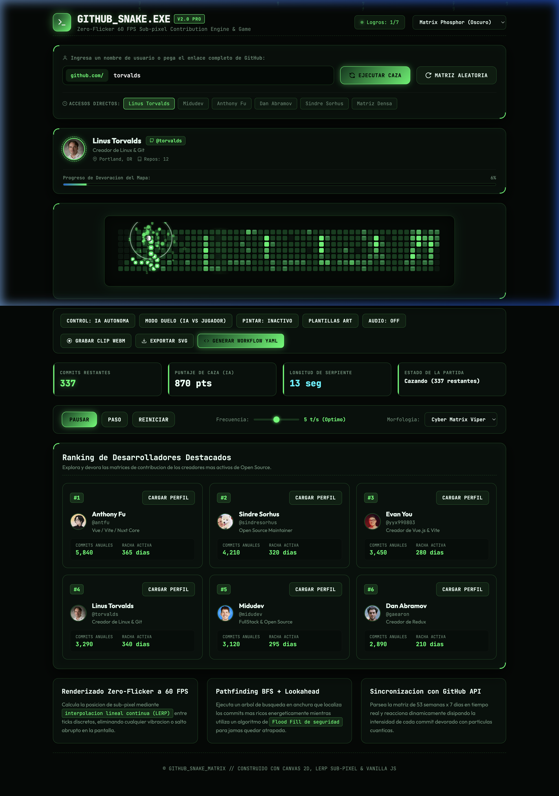
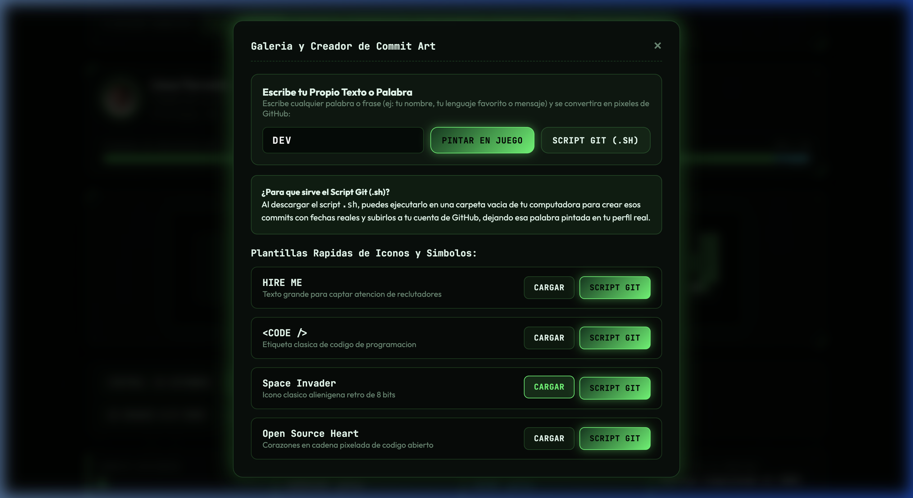
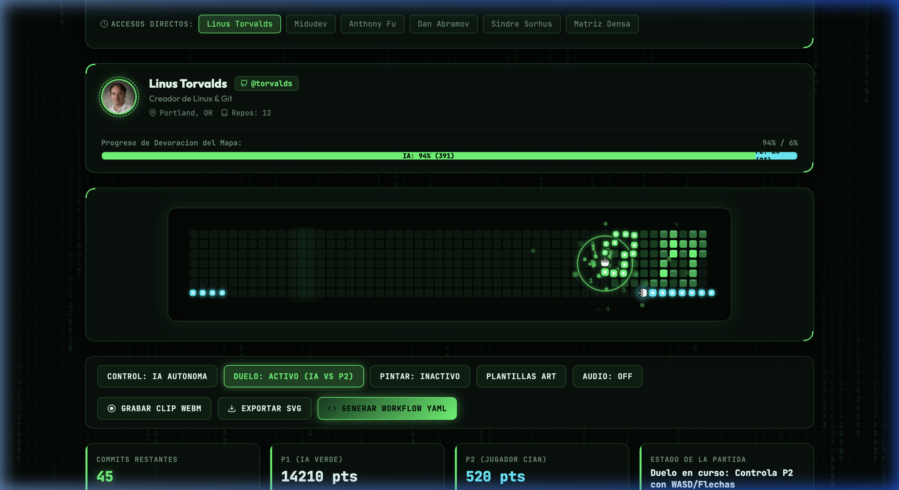

<p align="center">
  
</p>

# GITHUB_SNAKE.EXE — Interactive GitHub Contribution Engine

<p align="center"><a href="README.en.md">English</a> · <b>Español</b></p>

> **Plataforma interactiva sobre Canvas 2D que transforma el historial de contribuciones de GitHub en una simulación a 60 FPS con IA (BFS + Flood Fill), generador de Commit Art y herramientas de exportación para desarrolladores.**

<p align="center">
  
</p>

<p align="center">
  <a href="https://luisrodriguez-rgb.github.io/GITHUB_SNAKE.EXE/">
    
  </a>
</p>

<p align="center">
  
  
  
  
  
</p>

---

> [!TIP]
> **Acceso Directo a la Demo Desplegada**:  
> Puedes interactuar con la simulación, competir en modo duelo y generar scripts de Commit Art en:  
> **https://luisrodriguez-rgb.github.io/GITHUB_SNAKE.EXE/**

---

## Estructura del Sistema en 3 Pilares

El proyecto está diseñado bajo una arquitectura modular desacoplada en tres componentes funcionales principales:

```
                                  GITHUB_SNAKE.EXE
                                          │
       ┌──────────────────────────────────┼──────────────────────────────────┐
       ▼                                  ▼                                  ▼
[ 1. ENGINE & AI ]              [ 2. COMMIT ART CREATOR ]         [ 3. DEVELOPER ECOSYSTEM ]
• Render LERP 60 FPS Sub-pixel  • Rasterizador tipográfico 53x7   • Web Component <github-snake>
• Pathfinding BFS + Lookahead   • Fuentes Bitmap A-Z / 0-9        • Exportador SVG Optimizado
• Modo Duelo (IA vs Jugador)    • Generador Bash Scripts (.sh)    • GitHub Action propia
• Síntesis Web Audio API        • Commits con fechas calculadas   • Seguridad Edge (_headers)
```

---

## 1. Motor de Simulación e Inteligencia Artificial (Engine & AI)

* **Renderizado Zero-Flicker a 60 FPS**:
  * Desacoplamiento de la frecuencia lógica de ticks ($1\text{ a }9\text{ t/s}$) y la tasa de refresco visual ($60\text{ FPS}$).
  * Interpolación lineal continua (LERP) a nivel de sub-píxel:
    $$\vec{P}(t) = \vec{P}_{\text{prev}} + (\vec{P}_{\text{curr}} - \vec{P}_{\text{prev}}) \cdot \text{progress}$$
  * Contornos de alto contraste y columna vertebral láser blanca para evitar que la serpiente se mimetice con las celdas verdes de fondo.
  * En los modos manual y duelo los bordes son toroidales, con *Ghost Segments* al cruzarlos sin cortes en pantalla. La IA no cruza bordes.
* **Toma de Decisiones de la IA (BFS + Flood Fill)**:
  * **BFS (Búsqueda en Anchura)**: Busca la ruta más corta hacia la celda con commits más cercana (a igual distancia, la de mayor intensidad).
  * **Lookahead de Seguridad (Flood Fill)**: Antes de ejecutar un movimiento, proyecta la posición de la cabeza y evalúa si el área libre restante es suficiente para el cuerpo de la serpiente, evitando encierros y colisiones.
* **Modos de Juego**:
  * **IA Autónoma**: Simulación automática auto-optimizada.
  * **Modo Manual**: Control directo con teclado (WASD / Flechas) con prevención de giros inversos.
  * **Modo Duelo**: Serpiente Verde (IA) vs Serpiente Cian (Jugador) con barra de progreso dual en tiempo real y pantalla de victoria/game over.
  * **Duelo de Perfiles**: dos usuarios reales de GitHub, la misma IA y 60 segundos. Gana el perfil cuya serpiente devora más puntos. El resultado depende solo de los ticks (es reproducible en cualquier equipo) y se comparte con un enlace: `?u=tu_usuario&vs=rival`.
  * **Enlaces directos**: `?u=usuario` abre la web con la cuadrícula de ese perfil.

---

## 2. Herramienta Creativa: Commit Art & Script Generator

* **Rasterizador Tipográfico Matricial**:
  * Convierte cualquier palabra personalizada (ej: tu nombre, `DEV`, `HIRE ME`, `REACT`) en una matriz de 53 semanas $\times$ 7 días.
  * Diccionario de fuentes bitmap $3\times5$ y $4\times5$ que centra automáticamente el texto en el año.
* **Variación Orgánica de Contribuciones**:
  * Cada celda del dibujo recibe intensidades variables (niveles 2, 3 y 4) y conteos aleatorios realistas ($14\text{ a }55+\text{ commits}$).
* **Generador de Scripts Git (`.sh`)**:
  * Produce scripts ejecutables que fijan `GIT_AUTHOR_DATE` y `GIT_COMMITTER_DATE` con la fecha exacta de cada celda de la cuadrícula de GitHub (53 semanas, domingo a sábado) para pintar ese dibujo en el perfil real.
  * Son commits vacíos y decorativos. Para que GitHub los cuente, el email de git debe estar verificado en tu cuenta y los commits deben subirse a la rama por defecto.

<p align="center">
  
</p>

---

## 3. Ecosistema para Desarrolladores & Integraciones

* **Componente Web Independiente ([`embed.js`](embed.js))**:
  * Etiqueta reutilizable bajo el estándar de Custom Elements v1 para incrustar la serpiente en cualquier sitio web o portafolio:
    ```html
    <script src="https://luisrodriguez-rgb.github.io/GITHUB_SNAKE.EXE/embed.js"></script>
    <github-snake user="torvalds" theme="dark" speed="5"></github-snake>
    ```
* **Exportador de SVG Animado Ultra Optimizado**:
  * Modal interactivo para personalizar velocidad ($3, 5, 8\text{ t/s}$), paleta de colores (*Dark, Light, Cyberpunk, Cyan, Amber*) y morfología.
  * Keyframes CSS compactos y minificados con resolución del salto de bordes y reinicio instantáneo en bucle ($0.6\text{s}$).
* **Tooltip Interactivo Estilo GitHub**:
  * Muestra al pasar el cursor la cantidad de commits, fecha formateada en español y nivel de actividad.
* **Grabador de Video HD WebM**:
  * Captura fluida a 60 FPS directamente desde el canvas con la API nativa de `MediaRecorder`.

<p align="center">
  
</p>

---

## Métricas de Rendimiento y Benchmarks

| Métrica / Módulo | Complejidad / Medición | Impacto Técnico |
| :--- | :--- | :--- |
| **Pathfinding BFS** | $\mathcal{O}(V + E)$ sobre 371 nodos | Mediana $0.04\text{ ms}$ y p95 $0.2\text{ ms}$ por tick (Node.js, 12.000 ticks sobre 4 matrices) |
| **Renderizado LERP** | 60 FPS estables | $0\text{ jank}$, interpolación matemática continua |
| **Peso SVG Exportado** | $\approx 65 - 95\text{ KB}$ | Barrido completo de la matriz, una sola trayectoria compartida por todos los segmentos |
| **Audio Procedural** | Web Audio API nativo | $0\text{ KB}$ en archivos de audio externos (sintetizado en tiempo real) |
| **Caché en Edge** (opcional) | Cache API de Cloudflare (1h TTL) | Una sola consulta a la API por perfil y hora |

---

## Arquitectura de Flujo de Datos

```
+-------------------------------------------------------------------------+
|                              CAPA DE ENTRADA                            |
|    GitHub API REST  │  Palabras Commit Art  │  WASD / Flechas Teclado   |
+--------------------------------────┬────────────────────────────────────+
                                     │
                                     ▼
+-------------------------------------------------------------------------+
|                         MATRIZ DE CONTRIBUCIONES                        |
|              Estructura normalizada de 53 columnas x 7 filas            |
|              Fechas calculadas, conteos dinámicos y niveles 0-4         |
+--------------------------------────┬────────────────────────────────────+
                                     │
                                     ▼
+-------------------------------------------------------------------------+
|                     MOTORES LÓGICOS Y PATHFINDING                       |
|   • IA Verde: Búsqueda BFS con lookahead de seguridad Flood Fill        |
|   • P2 Cian: Control manual con normalización de dirección toroidal     |
|   • Scoring: Puntos por nivel de intensidad y detección de fin de juego |
+--------------------------------────┬────────────────────────────────────+
                                     │
                                     ▼
+-------------------------------------------------------------------------+
|                     MOTOR DE RENDERIZADO CANVAS 2D                      |
|   • requestAnimationFrame a 60 FPS con LERP sub-píxel                   |
|   • Contorno de alto contraste + Columna vertebral láser brillante      |
|   • Ondas de choque (Shockwaves), partículas cuánticas y scanlines      |
|   • Tooltip flotante dinámico sincronizado con coordenadas de mouse     |
+--------------------------------────┬────────────────────────────────────+
                                     │
                                     ▼
+-------------------------------------------------------------------------+
|                       EXPORTACIÓN Y AUTOMATIZACIÓN                      |
|   • Exportador SVG minificado con keyframes CSS optimizados             |
|   • Grabador de video WebM a 60 FPS (MediaRecorder nativo)              |
|   • Generador de scripts Git (.sh) y GitHub Action con el mismo motor   |
+-------------------------------------------------------------------------+
```

---

## Estructura del Código Fuente

```
.
├── index.html            # Interfaz semántica, HUD, tooltips, modales y canvas
├── style.css             # Design tokens, paletas de color, efectos glassmorphism
├── favicon.svg           # Favicon y logo vectorial SVG oficial de alta resolución
├── embed.js              # Web Component autónomo <github-snake> para portafolios
├── action.yml            # GitHub Action: genera los SVG animados en tu perfil
├── api/snake.js          # Función serverless (Vercel) del endpoint /api/<usuario>.svg
├── shared/snake-core.js  # Opciones del SVG y calendario GraphQL, compartido por Action y endpoint
├── vercel.json           # Reescritura /api/<usuario>.svg y archivos incluidos en la función
├── action/               # Punto de entrada de la Action (Node.js, sin dependencias)
├── tests/                # Tests de la Action (node --test tests/*.test.js)
├── _headers              # Cabeceras de seguridad HTTP, HSTS, CSP y caché para producción
├── assets/               # Capturas de pantalla, previews y recursos visuales
│   ├── logo.svg          # Logo vectorial oficial del proyecto
│   ├── hero_preview.png  # Captura de interfaz principal
│   ├── duel_mode.png     # Captura del modo duelo IA vs Jugador
│   ├── commit_art.png    # Captura del creador de Commit Art
│   └── demo_recording.webp # Grabación de sesión
├── docs/
│   └── production_guide.md # Guía de arquitectura, seguridad, proxies y analíticas
├── server/
│   └── edge_proxy_worker.js # Proxy Edge opcional con caché de 1 hora
├── js/
│   ├── achievements.js   # Sistema de medallas, persistencia y eventos
│   ├── audio.js          # Sintetizador procedural Web Audio API
│   ├── calendar.js       # Geometría de la cuadrícula (fecha de cada celda)
│   ├── duel.js           # Duelo de perfiles: dos matrices reales, misma IA, ticks fijos
│   ├── exporter.js       # Exportador SVG con barrido 100% y generador YAML
│   ├── github.js         # API Fetcher, cálculo de fechas y ranking de devs
│   ├── pathfinding.js    # Algoritmo BFS y evaluación de seguridad Flood Fill
│   ├── recorder.js       # Motor de grabación HD WebM en navegador
│   ├── renderer.js       # Renderizado Canvas 2D con alto contraste y LERP
│   ├── snake.js          # Máquina de estados, segmentos y partículas
│   ├── templates.js      # Rasterizador de fuentes bitmap y scripts Bash Git
│   └── app.js            # Orquestador maestro, bucle principal y eventos DOM
├── README.md             # Documentación técnica del repositorio
└── snake_link.md         # Especificación matemática de algoritmos
```

---

## Guía Detallada: Cómo Integrar la Serpiente en tu Perfil de GitHub

GitHub cuenta con una funcionalidad especial donde el archivo `README.md` de un repositorio con tu mismo nombre de usuario se convierte en la portada principal de tu perfil.

### Paso 1: Crear tu Repositorio Especial
1. Ve a [github.com/new](https://github.com/new).
2. En **Repository name**, escribe exactamente tu nombre de usuario de GitHub (ejemplo: `luisrodriguez-rgb`).
3. Verás un mensaje informativo confirmando que has desbloqueado el repositorio especial.
4. Asegúrate de que esté configurado como **Public** y marca la casilla **Add a README file**.
5. Haz clic en **Create repository**.

### Paso 2: Habilitar Permisos de Escritura para GitHub Actions
Para que la acción automatizada pueda guardar el archivo SVG generado en tu repositorio sin errores de permisos:
1. En tu repositorio `usuario/usuario`, ve a la pestaña **Settings** (Configuración).
2. En la barra lateral izquierda, entra en **Actions** -> **General**.
3. Baja hasta la sección **Workflow permissions**.
4. Marca la opción **Read and write permissions**.
5. Marca la casilla **Allow GitHub Actions to create and approve pull requests**.
6. Haz clic en **Save**.

### Paso 3: Crear el Workflow Automatizado (`snake.yml`)

El repositorio incluye una GitHub Action propia ([`action.yml`](action.yml)) que ejecuta el mismo motor de la web: IA BFS + Flood Fill, barrido del 100% de la matriz y los mismos temas. Lee tu calendario con la API GraphQL oficial de GitHub, así que la cuadrícula coincide con la de tu perfil.

1. Dentro de tu repositorio especial, crea el archivo `.github/workflows/snake.yml`.
2. Copia esta configuración (reemplaza `TU_USUARIO` por tu usuario de GitHub). También puedes generarla ya rellenada con el botón **Poner en mi perfil (Workflow)** de la web, donde eliges el estilo con vista previa.

```yaml
name: GitHub Snake

on:
  # Se regenera cada dia a medianoche (UTC)
  schedule:
    - cron: "0 0 * * *"
  # Permite ejecutarlo a mano desde la pestana Actions
  workflow_dispatch:
  push:
    branches:
      - main

jobs:
  generate:
    permissions:
      contents: write
    runs-on: ubuntu-latest
    timeout-minutes: 5

    steps:
      - name: Generate Snake SVG
        uses: luisrodriguez-rgb/GITHUB_SNAKE.EXE@v1
        with:
          github_user_name: TU_USUARIO
          outputs: |
            dist/github-snake.svg?theme=light
            dist/github-snake-dark.svg?theme=dark

      - name: Deploy to Output Branch
        uses: crazy-max/ghaction-github-pages@v4
        with:
          target_branch: output
          build_dir: dist
        env:
          GITHUB_TOKEN: ${{ secrets.GITHUB_TOKEN }}
```

**Opciones de cada salida** (formato query string tras la ruta `.svg`):

| Opción | Valores | Por defecto |
| :--- | :--- | :--- |
| `theme` | `dark`, `light`, `cyberpunk`, `neon_cyan`, `amber_terminal` | `dark` |
| `speed` | `normal`, `fast`, `relaxed` | `normal` |
| `morph` | `matrix_viper`, `capsule`, `retro` | `matrix_viper` |
| `pause` | `fast`, `medium`, `none` | `fast` |

Ejemplo: `dist/snake-neon.svg?theme=neon_cyan&speed=fast&morph=capsule`.

### Paso 4: Ejecutar el Workflow por Primera Vez
1. Ve a la pestaña **Actions** de tu repositorio.
2. En el menú izquierdo, selecciona **GitHub Snake**.
3. Haz clic en el botón desplegable **Run workflow** -> **Run workflow**.
4. Una vez completado en verde, se habrá creado automáticamente la rama `output` con los SVG generados.

### Paso 5: Mostrar la Animación en tu Portada
Edita tu `README.md` principal y agrega este bloque para soporte automático en modo oscuro y claro:

```markdown
### Mi Matriz de Contribuciones

<picture>
  <source media="(prefers-color-scheme: dark)" srcset="https://raw.githubusercontent.com/TU_USUARIO/TU_USUARIO/output/github-snake-dark.svg">
  <source media="(prefers-color-scheme: light)" srcset="https://raw.githubusercontent.com/TU_USUARIO/TU_USUARIO/output/github-snake.svg">
  
</picture>
```

### Alternativa: enlace directo sin workflow (endpoint SVG)

El repositorio incluye una función serverless ([`server/snake-svg.js`](server/snake-svg.js)) que sirve el SVG al vuelo con el mismo motor:

```html

```

Acepta las mismas opciones que la Action (`theme`, `speed`, `morph`, `pause`). Si algo falla, devuelve un SVG con el motivo (usuario inexistente, opción no válida...) en lugar de una imagen rota.

**Desplegarlo en Vercel (plan Hobby gratuito):**
1. Importa este repositorio en [vercel.com/new](https://vercel.com/new) (framework: *Other*, sin comando de build).
2. Crea un token en GitHub: *Settings → Developer settings → Fine-grained tokens*, **sin ningún permiso** (solo hace falta leer datos públicos).
3. En Vercel, añade la variable de entorno `GITHUB_TOKEN` con ese token y despliega.
4. Prueba `https://TU-PROYECTO.vercel.app/api/TU_USUARIO.svg?theme=dark`.
5. Para que la web ofrezca la opción **Enlace directo**, pon esa URL base en `<meta name="snake-api" content="...">` de `index.html`.

Cada SVG se cachea 6 horas en la CDN por usuario y combinación de opciones, así que el token apenas consume su límite de la API. No se usa Cloudflare Workers porque generar un SVG cuesta ~70-200 ms de CPU y su plan gratuito permite 10 ms.

---

## Ejecución en Local

1. **Clonar el repositorio**:
   ```bash
   git clone https://github.com/luisrodriguez-rgb/GITHUB_SNAKE.EXE.git
   cd GITHUB_SNAKE.EXE
   ```

2. **Iniciar servidor web local**:
   ```bash
   # Opción A: Python
   python3 -m http.server 3000

   # Opción B: Node.js
   npx serve .
   ```

3. **Abrir en el navegador**:
   Visita `http://localhost:3000` en tu navegador.

4. **Al publicar cambios de CSS o JS**: cambia el valor de `?v=` en `index.html` (el mismo en todas las etiquetas). GitHub Pages deja que el navegador reutilice esos archivos durante 10 minutos; sin cambiar la versión, un visitante puede recibir el HTML nuevo con CSS/JS viejos. `node --test tests/*.test.js` comprueba que todas las etiquetas lleven la misma versión.

---

## Licencia

Distribuido bajo la Licencia **MIT**. Diseñado y desarrollado como software libre de alto rendimiento para la comunidad de desarrolladores.
